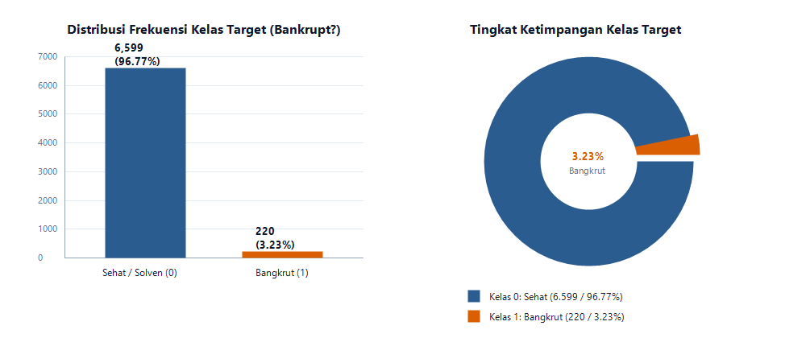
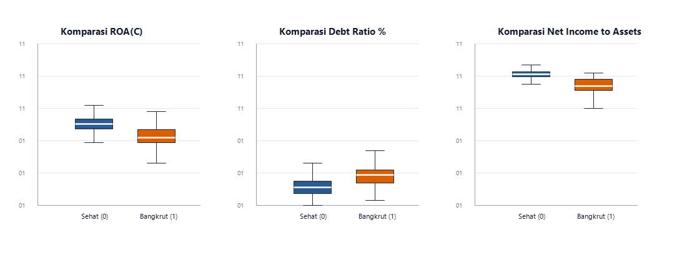
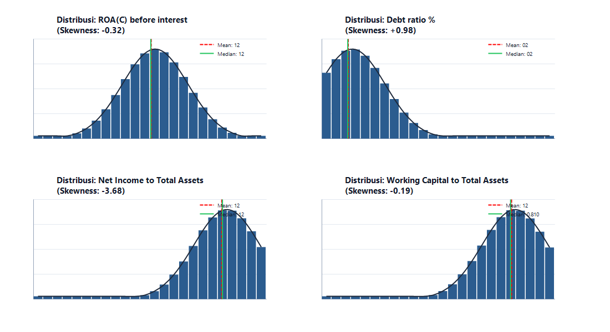
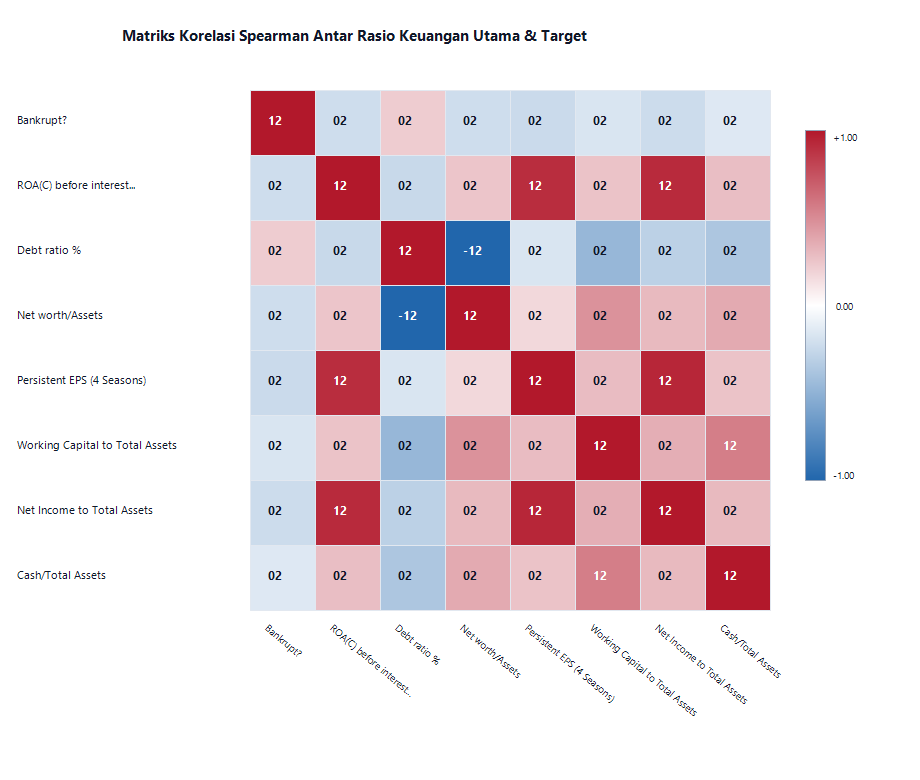

# 📊 Analisis Kesehatan Keuangan Korporasi & Prediksi Kebangkrutan

[](https://www.python.org/)
[](https://en.wikipedia.org/wiki/Cross-industry_standard_process_for_data_mining)
[](https://www.kaggle.com/)
[](#1-distribusi-kelas-target--class-imbalance)
[](#rekomendasi-pemodelan-machine-learning)

---

### 📌 Ringkasan Eksekutif Proyek
Proyek ini melakukan analisis eksplorasi data (*Exploratory Data Analysis* / EDA) komprehensif untuk mendeteksi secara dini tingkat kesehatan finansial perusahaan dan risiko kebangkrutan korporasi (*Corporate Financial Distress & Bankruptcy Prediction*). Analisis ini menggunakan kerangka kerja standar industri **CRISP-DM** 

* **Dataset Sumber:** *Taiwan Economic Journal (TEJ)* via Kaggle (6.819 Perusahaan, 96 Fitur Keuangan).
* **Lokasi Data:** [`DATA_SHEET/data.csv`](DATA_SHEET/data.csv)
* **Status Audit Data:** 100% lengkap (**0 nilai kosong**). Fitur konstan `Net Income Flag` (varian = 0) berhasil dieliminasi menyisakan 95 prediktor kontinu.

---

## 📈 HASIL ANALISIS VISUAL & TEMUAN EMPIRIS

### 1. Distribusi Kelas Target & Class Imbalance
Permasalahan utama dalam prediksi kebangkrutan korporasi adalah **ketimpangan kelas yang sangat tajam (*extreme class imbalance*)**, di mana kebangkrutan merupakan fenomena kejadian langka (*rare event*).

<p align="center">
  
</p>

* **Fakta Empiris Data:**
  * **Kelas 0 (Perusahaan Sehat / Solven):** 6.599 perusahaan (**96.77%**)
  * **Kelas 1 (Perusahaan Bangkrut / Distress):** 220 perusahaan (**3.23%**)
* **Implikasi Metodologis (Jebakan Akurasi):**  
  Model naif yang memprediksi seluruh entitas sebagai "Sehat" akan memperoleh akurasi **96.77%**, namun memiliki **Recall 0%** (gagal mendeteksi seluruh 220 kebangkrutan). Oleh karena itu, metrik akurasi dasar (*accuracy*) wajib ditinggalkan demi metrik **Recall** ($\ge 85\%$) dan **ROC-AUC** ($\ge 0.88$), dipadukan dengan teknik penyeimbangan **SMOTE**.

---

### 2. Analisis Bivariat: Profil Emiten Sehat vs Bangkrut
Komparasi sebaran statistik antara kelompok korporasi sehat dan bangkrut memperlihatkan jurang pemisah yang sangat kontras pada pilar profitabilitas dan solvabilitas:

<p align="center">
  
</p>

* **Profitabilitas (`ROA(C)`):**
  * Perusahaan sehat mencatatkan median ROA stabil di **0.505**, sedangkan perusahaan bangkrut merosot tajam ke **0.420** dengan nilai minimum menyentuh $0.00$.
* **Rasio Solvabilitas & Utang (`Debt ratio %`):**
  * Median beban utang perusahaan sehat berada di **0.111 (11.1%)**. Sebaliknya, pada perusahaan bangkrut median melonjak drastis ke **0.187 (18.7%)** — mengindikasikan beban leverage yang **~68% lebih tinggi**.
* **Efisiensi Laba Bersih (`Net Income to Total Assets`):**
  * Perusahaan bangkrut mengalami pergeseran distribusi ke bawah (median **0.738** vs **0.811** pada perusahaan sehat) dengan kumpulan pencilan kerugian operasional yang masif.

---

### 3. Eksplorasi Karakteristik & Bentuk Distribusi (Skewness & Kurtosis)
Rasio keuangan korporasi secara inheren melanggar asumsi distribusi normal karena dihuni oleh ekor panjang (*fat tails*) dari entitas yang mengalami guncangan krisis finansial:

<p align="center">
  
</p>

* **Kecondongan Ekstrem (*Heavy Skewness*):**
  * `Persistent EPS in the Last Four Seasons`: Memiliki *skewness* positif tinggi (**+5.14**) dan *kurtosis* sangat tajam (**81.62**), menunjukkan dominasi kinerja rata-rata dengan sejumlah kecil emiten laba luar biasa di sisi kanan.
  * `Net Income to Total Assets`: Menunjukkan *skewness* negatif tajam (**-3.68**) dengan ekor kiri panjang dari perusahaan-perusahaan yang menderita kerugian operasional masif menjelang kebangkrutan.
* **Justifikasi Model:** Nilai *kurtosis* $\gg 3$ menegaskan kehadiran *heavy tails*, yang membuktikan keunggulan algoritma non-parametrik berbasis pohon (*tree-based models*) dibandingkan model linear klasik.

---

### 4. Matriks Korelasi Spearman: Pemicu vs Pelindung Solvabilitas
Karena distribusi data miring dan memuat pencilan, digunakan koefisien **Korelasi Spearman Peringkat (*Spearman's Rank Correlation*)**:

<p align="center">
  
</p>

#### Peringkat Faktor Penentu Kebangkrutan Korporasi:
| Kategori Pengaruh | Fitur Rasio Keuangan | Koefisien ($r_s$) | Interpretasi Finansial |
| :--- | :--- | :---: | :--- |
| **Pemicu Risiko Terkuat** | `Total debt/Total net worth` | **+0.2193** | Beban utang relatif terhadap modal ekuitas adalah pemicu kebangkrutan utama. |
| **Pemicu Risiko** | `Debt ratio %` | **+0.2172** | Tingginya persentase aset yang didanai melalui kewajiban utang luar. |
| **Pemicu Risiko** | `Borrowing dependency` | **+0.2151** | Ketergantungan modal kerja terhadap pinjaman luar. |
| **Pelindung Terkuat** | `Persistent EPS (4 Seasons)` | **-0.2382** | Konsistensi laba per saham dalam 4 kuartal berturut-turut adalah penangkal krisis paling tangguh. |
| **Pelindung Solvabilitas** | `Net Income to Total Assets` | **-0.2343** | Kemampuan aset dalam menghasilkan laba bersih positif bagi korporasi. |
| **Pelindung Solvabilitas** | `Retained Earnings to Total Assets` | **-0.2295** | Akumulasi saldo laba ditahan sebagai bantalan modal penyerap kerugian. |

---

### 5. Strategi Penanganan Pencilan: Winsorization (IQR Capping)
Audit menggunakan metode Rentang Interkuartil ($Q_1 - 1.5 \times \text{IQR}$ hingga $Q_3 + 1.5 \times \text{IQR}$) mendeteksi **391 pencilan pada ROA (5.73%)** dan **224 pencilan pada Debt Ratio (3.28%)**.

* **Justifikasi Akademis:**  
  Pencilan dalam data finansial **bukan merupakan kesalahan input (*noise*)**, melainkan representasi nyata dari perusahaan yang tengah kolaps. Oleh karena itu, metode penghapusan (*trimming*) ditolak secara tegas.
* **Solusi Terpilih:** **Winsorization (IQR Capping)**, di mana nilai-nilai ekstrem di luar batas toleransi dipatok tepat pada batas atas dan batas bawah IQR, meredam distorsi varians tanpa membuang satu pun baris data emiten krisis.

---

## 🤖 Rekomendasi Pemodelan Machine Learning

Berdasarkan seluruh temuan EDA, rancangan arsitektur pemodelan tahap selanjutnya adalah:
1. **Penyeimbangan Kelas (*Imbalance Mitigation*):**  
   Menerapkan algoritma **SMOTE (*Synthetic Minority Over-sampling Technique*)** pada *training set* dipadukan dengan pembobotan penalti kelas (`scale_pos_weight` / `class_weight='balanced'`).
2. **Algoritma Rekomendasi Utama:**  
   **Gradient Boosted Decision Trees (XGBoost / LightGBM)** karena kebal terhadap multikolinearitas antar-rasio, adaptif terhadap distribusi miring (*skewed*), dan sangat tangguh menangani residu pencilan finansial.
3. **Kriteria Ambang Batas (*Decision Threshold*):**  
   Mengunci ambang batas klasifikasi untuk mengoptimalkan **Recall $\ge 85\%$** dan **ROC-AUC $\ge 0.88$** guna meminimalkan kerugian modal kredit macet (*False Negative*).

---

## 🗂 Struktur Repositori Proyek

```text
├── DATA_SHEET/
│   └── data.csv                         <- Dataset sumber TEJ (6.819 observasi, 96 kolom)
├── images/
│   ├── distribusi_kelas_target.png      <- Grafik bar & pie chart ketimpangan kelas 3.23%
│   ├── komparasi_boxplot_sehat_bangkrut.png <- Grafik boxplot perbandingan rasio keuangan
│   ├── distribusi_rasio_keuangan.png    <- Grafik histogram & kurva KDE skewness data
│   └── heatmap_korelasi_spearman.png    <- Visualisasi matriks heatmap korelasi Spearman
├── financial_health_eda.ipynb           <- Jupyter Notebook lengkap hasil eksekusi Colab (22 sel)
├── financial_health_eda.py              <- Skrip Python murni
├── LAPORAN_LENGKAP_EDA_UTS.html         <- Dokumen Laporan Akhir UTS (PDF-ready, Ctrl+P)
├── LAPORAN_LENGKAP_EDA_UTS.md           <- Naskah Laporan Akhir format Markdown (Bab 1 - 9)
├── PRESENTASI_EDA_KESEHATAN_KEUANGAN.html <- Slide Presentasi Interaktif (Fullscreen F11)
├── RANGKUMAN_SLIDE_PRESENTASI_UTS.md    <- Outline slide presentasi & naskah pembicara
└── README.md                            <- Dokumentasi utama proyek di GitHub
```

---

## 🚀 Panduan Menjalankan Analisis

1. **Jupyter Notebook / Google Colab:**
   * Buka [Google Colab](https://colab.research.google.com) lalu unggah [`financial_health_eda.ipynb`](financial_health_eda.ipynb).
   * Letakkan [`DATA_SHEET/data.csv`](DATA_SHEET/data.csv) pada folder kerja Colab.
   * Pilih menu **Runtime > Run all**.
2. **Membuka Bahan Presentasi:**
   * Buka [`PRESENTASI_EDA_KESEHATAN_KEUANGAN.html`](PRESENTASI_EDA_KESEHATAN_KEUANGAN.html) di peramban dan tekan **F11** untuk memulai mode presentasi interaktif.
3. **Mencetak Laporan PDF:**
   * Buka [`LAPORAN_LENGKAP_EDA_UTS.html`](LAPORAN_LENGKAP_EDA_UTS.html) di browser, tekan **Ctrl + P**, dan pilih **Save as PDF**.
